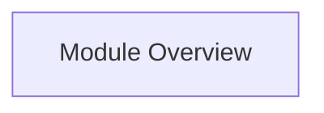
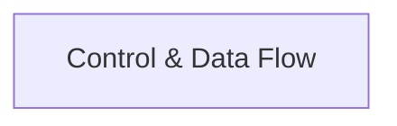

# Technical Design Document

<!-- SECTION:design-sec1:START:exempt -->
## 1. Architecture Overview

<!-- AUTO-DIAGRAM:module-overview:START -->

<!-- AUTO-DIAGRAM:module-overview:END -->

<!-- SECTION:design-sec1:END -->

<!-- SECTION:design-sec2:START -->
## 2. Components & Modules

<!-- SECTION:design-sec2:END -->

<!-- SECTION:design-sec3:START -->
## 3. Control & Data Flows

<!-- AUTO-DIAGRAM:flow-overview:START -->

<!-- AUTO-DIAGRAM:flow-overview:END -->

<!-- SECTION:design-sec3:END -->

<!-- SECTION:design-sec4:START -->
## 4. Data Model

<!-- SECTION:design-sec4:END -->

<!-- SECTION:design-sec5:START -->
## 5. Interfaces & Entry Points

<!-- SECTION:design-sec5:END -->

<!-- SECTION:design-sec6:START -->
## 6. Security

<!-- SECTION:design-sec6:END -->

<!-- SECTION:design-sec7:START -->
## 7. Deployment & Infrastructure

<!-- SECTION:design-sec7:END -->

<!-- SECTION:design-sec8:START -->
## 8. Known Gaps & Limitations

<!-- SECTION:design-sec8:END -->

<!-- SECTION:design-references:START:exempt -->
## References

<!-- SECTION:design-references:END -->
